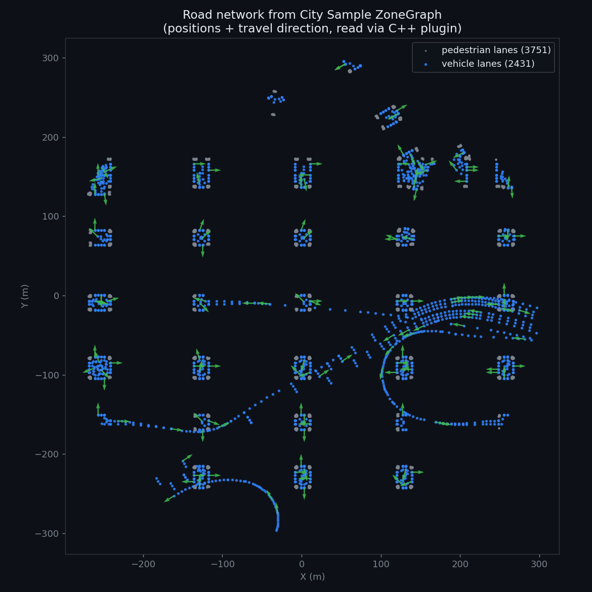
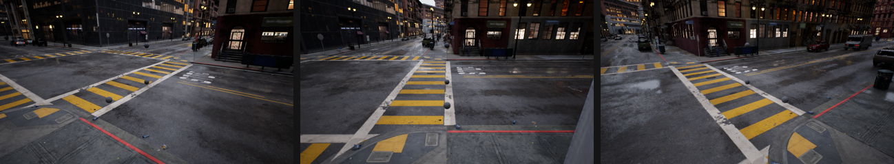
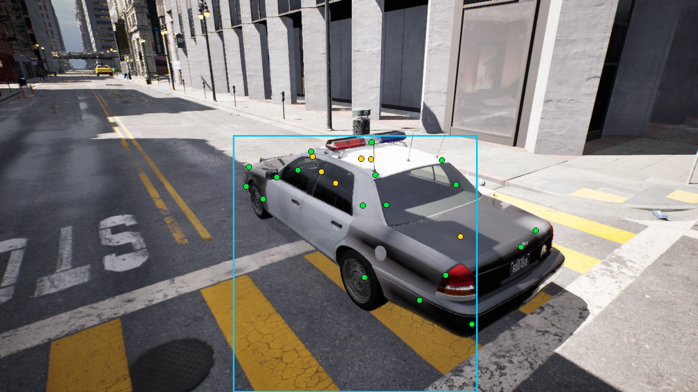

# ue5-vehicle-synth

[](https://github.com/kiselyovd/ue5-vehicle-synth/actions/workflows/ci.yml)
[](https://kiselyovd.github.io/ue5-vehicle-synth/)
[](LICENSE)
[](https://www.python.org/)
[](https://www.unrealengine.com/)

A synthetic vehicle-keypoint dataset pipeline built on Unreal Engine 5 and Epic's City Sample. It places vehicles on the real road network, renders photoreal frames through Movie Render Queue, and exports COCO keypoint annotations for training the [`vehicle-keypoints`](https://github.com/kiselyovd/vehicle-keypoints) model.

**Russian version:** [README.ru.md](README.ru.md)


> **Full demo video:** [`docs/videos/demo.mp4`](docs/videos/demo.mp4) - three scenes, each a single vehicle driving normally, then with its 24-point keypoint skeleton, then as a wireframe ghost, across different locations and lighting. Rendered in City Sample through Movie Render Queue.

## Status

**Capture pipeline built; the Phase 0 sim-to-real experiment is complete.** The published dataset contains **2,510 frames** with a 24-point keypoint schema: [City Sample vehicle-keypoints dataset](https://huggingface.co/datasets/kiselyovd/citysample-vehicle-keypoints-24pt).

The acceptance criterion was **+2 pp OKS-mAP** on the held-out CarFusion test set. In the matched experiments with corrected flip augmentation, the synthetic supplement instead reduced OKS-mAP by **1.7 pp** from a weak checkpoint and **9.5 pp** from a strong one. The criterion was not met. This result concerns the tested 2D transfer recipe; it does not measure the pipeline's utility for other tasks.

Read the [experiment and error analysis](https://github.com/kiselyovd/vehicle-keypoints/blob/main/docs/phase0/synthetic-pretraining.md) for the two-arm protocol, augmentation fix, and next hypotheses. The [Wiki](wiki/Home.md) covers the capture workflow.

## Why

Real vehicle-keypoint data is scarce and expensive to label. A simulator provides projected annotations and controlled variation in viewpoints, lighting, and available vehicle assets. This project builds the generator as a reusable Unreal Engine C++ plugin (`UESynthCapture`) and uses it to extend `vehicle-keypoints` from a 14-point to a 24-point schema for controlled sim-to-real experiments.

The narrative is deliberately concrete: frames are rendered inside Epic's "Matrix Awakens" City Sample, so the dataset carries a recognizable, high-fidelity look while staying fully redistributable (see [Legal](#legal)).

## How it works

The pipeline decouples annotation (fast, in-editor) from rendering (gold-path, offline):

1. **Road detection.** A C++ wrapper (`USynthRoadQuery`) reads City Sample's baked ZoneGraph lane network directly from the engine and returns lane positions plus travel directions. The vehicle rig is placed on a real lane, aligned to traffic direction. A road-surface raycast path is the automatic fallback when ZoneGraph data is absent.

   

2. **Keypoint projection.** For each camera pose, the `USynthVehicleAnnotator` component projects 24 anatomical keypoints to pixels and runs a bidirectional occlusion trace to assign CarFusion-style visibility (`v=2` visible, `v=1` self-occluded, `v=0` off-frame). The bounding box is derived from the vehicle mesh bounds so it reaches the tire bottoms like real annotations. All visible city vehicles in frame are labeled, not just the rig.

3. **Gold-path render.** A keyframed Level Sequence drives one camera through every pose; Movie Render Queue renders each as a sharp 1280x720 frame with full Lumen global illumination and ray tracing (motion blur disabled for crisp stills).

   

4. **Export.** Per-frame JSONL is converted to a validated multi-instance COCO keypoint dataset, then consumed by the `vehicle-keypoints` training pipeline.

### Keypoint labels on a real vehicle

Every vehicle is labeled with the full 24-point schema plus a mesh-bounds bounding box that reaches the tire bottoms like hand annotations. Points are colored by visibility (green visible, yellow self-occluded), and the projection is calibrated against the actual render so the labels land on pixels:



## The 24-point schema

The first 14 points are the CarFusion canonical order (wheels, head and tail lights, roof corners, center, exhaust) for forward compatibility with the v1 model. Ten new points (side mirrors, bumper corners, window-base corners) extend the schema. Keypoint anchors are defined per vehicle type in `configs/vehicles/`.

## Tech stack

Unreal Engine 5.6 + City Sample, a C++ capture plugin (`UESynthCapture`), in-editor Python via UnrealMCP, Movie Render Queue, Python 3.13 with uv / ruff / pytest, and ultralytics YOLO-pose on the training side.

## Quick start (Python side)

```bash
uv sync --all-groups
uv run pytest
```

The Unreal capture side requires UE 5.6 and the City Sample project; see the [Wiki](wiki/Home.md) for the capture workflow.

## Legal

Frames are rendered from Epic's City Sample. Under the Unreal Engine EULA, non-interactive media (images) rendered with the engine are freely distributable; only the underlying UE-Only-Content asset files are not. This dataset ships rendered PNG frames and JSON annotations only - never Epic asset files - so it stays within the license. Full analysis: [docs/legal/CITY_SAMPLE_EULA_REVIEW.md](docs/legal/CITY_SAMPLE_EULA_REVIEW.md).

## License

MIT - see [LICENSE](LICENSE). The MIT license covers this repository's code and the rendered frames / annotations it produces, not Epic's underlying assets.
