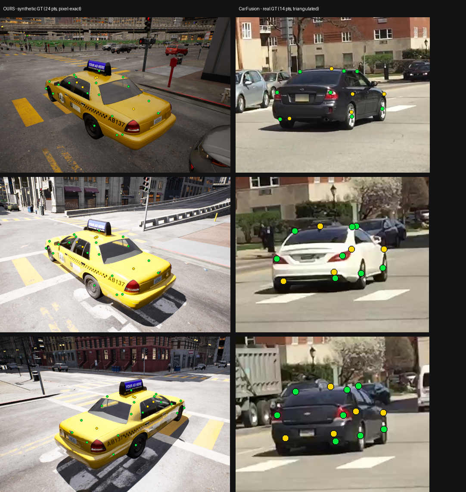

# ue5-vehicle-synth

[Open the interactive showcase](showcase.md)

<em>Synthetic vehicle-keypoint datasets, rendered inside Epic's City Sample with Unreal Engine 5.</em>

<em>Full demo: <a href="videos/demo.mp4">videos/demo.mp4</a> - three scenes, each a single vehicle driving normally, then with its 24-point keypoint skeleton, then as a wireframe ghost.</em>

Real vehicle-keypoint data is scarce and expensive to label. A game engine provides projected annotations and controlled variation in viewpoints, lighting, and available vehicle assets. This project builds that generator as a reusable Unreal Engine C++ plugin and uses it to extend the [`vehicle-keypoints`](https://github.com/kiselyovd/vehicle-keypoints) model from a 14-point to a 24-point schema for controlled sim-to-real experiments.

-   :material-city:{ .lg .middle } __Rendered in the Matrix city__

    ---

    Frames come from Epic's City Sample, so the dataset carries a recognizable, high-fidelity look while staying fully redistributable.

    [:octicons-arrow-right-24: How it works](pipeline.md)

-   :material-vector-point:{ .lg .middle } __24-point schema__

    ---

    The first 14 points are the CarFusion canonical order; ten new points (mirrors, bumper and window corners) extend it.

    [:octicons-arrow-right-24: The schema](#the-24-point-schema)

-   :material-flask-outline:{ .lg .middle } __Honest evaluation__

    ---

    A kill switch gates the work: synthetic pre-training must measurably beat the real baseline, or the result is reported as-is.

    [:octicons-arrow-right-24: Status](#status)

-   :material-book-open-variant:{ .lg .middle } __Run it yourself__

    ---

    Step-by-step setup, capture, configuration, and troubleshooting guides.

    [:octicons-arrow-right-24: Project Wiki](https://github.com/kiselyovd/ue5-vehicle-synth/wiki)

## How it works

The pipeline decouples **annotation** (fast, in-editor) from **rendering** (gold-path, offline), kept in lockstep by a keyframed Level Sequence so every rendered frame has a matching label.

=== "1. Road detection"

    A C++ wrapper reads City Sample's baked **ZoneGraph** lane network directly from the engine and returns lane positions plus travel directions. The vehicle is placed on a real lane, aligned to traffic.

    

=== "2. Keypoint projection"

    For each pose, 24 anatomical keypoints are projected to pixels with a bidirectional occlusion trace for CarFusion-style visibility, and a mesh-bounds bounding box that reaches the tire bottoms. Every visible city vehicle is labelled, not just the rig.

    

=== "3. Gold-path render"

    A single camera is keyframed through every pose; **Movie Render Queue** renders each as a sharp 1280x720 frame with full Lumen global illumination.

    

=== "4. Export"

    Per-frame records become a validated multi-instance **COCO** keypoint dataset, consumed directly by the `vehicle-keypoints` training pipeline.

[Read the full engineering walkthrough :octicons-arrow-right-24:](pipeline.md){ .md-button }

## The 24-point schema

| Range | Points | Group |
|---|---|---|
| 0-3 | 4 wheels | CarFusion canonical |
| 4-7 | head / tail lights | CarFusion canonical |
| 8 | exhaust | CarFusion canonical |
| 9-12 | 4 roof corners | CarFusion canonical |
| 13 | body center | CarFusion canonical |
| 14-15 | 2 side mirrors | extension |
| 16-19 | 4 bumper corners | extension |
| 20-23 | 4 window-base corners | extension |

Keeping points 0-13 in the exact CarFusion order means a 24-point model stays backward-compatible with the v1 14-point evaluation. Anchors are defined per vehicle type in `configs/vehicles/`.

## Status

!!! info "Capture pipeline built; Phase 0 experiment complete"
    The published dataset contains **2,510 frames** with 24-point keypoint annotations. The capture pipeline and the transfer experiment are separate deliverables.

The acceptance criterion was **+2 pp OKS-mAP** on the held-out CarFusion test set. In the matched experiments with corrected flip augmentation, the synthetic supplement reduced OKS-mAP by **1.7 pp** from the weak checkpoint and **9.5 pp** from the strong one. The criterion was not met for the tested 2D transfer recipe.

Read the [experiment and error analysis](https://github.com/kiselyovd/vehicle-keypoints/blob/main/docs/phase0/synthetic-pretraining.md) for the two-arm protocol, augmentation fix, and follow-up hypotheses.

## Results & label quality

The synthetic-only model's in-domain benchmark is reported in the [experiment write-up](https://github.com/kiselyovd/vehicle-keypoints/blob/main/docs/phase0/synthetic-pretraining.md#why-the-raw-number-is-not-the-whole-story). Learnable projected labels do not by themselves establish transfer to real road images.

The comparison below shows projected synthetic ground truth (24 points) alongside multi-view-triangulated CarFusion ground truth (14 points):

The later mesh-derived and per-keypoint controls did not support label geometry as the cause of the transfer penalty. Appearance and vehicle coverage remain hypotheses in the report.

## Get it

-   :material-github:{ .lg .middle } __Source__

    ---

    Plugin, capture scripts, COCO export, configs.

    [:octicons-arrow-right-24: github.com/kiselyovd/ue5-vehicle-synth](https://github.com/kiselyovd/ue5-vehicle-synth)

-   :material-database-outline:{ .lg .middle } __Dataset__

    ---

    2,510 rendered frames + multi-instance COCO on the Hub.

    [:octicons-arrow-right-24: HuggingFace dataset](https://huggingface.co/datasets/kiselyovd/citysample-vehicle-keypoints-24pt)

## Legal

Frames are non-interactive media rendered with Unreal Engine from City Sample. Under the UE EULA, such rendered images are freely distributable; only the underlying UE-Only-Content asset files are not. This project ships rendered PNG frames and JSON annotations only - never Epic asset files. Full analysis: [City Sample EULA review](legal/CITY_SAMPLE_EULA_REVIEW.md).
