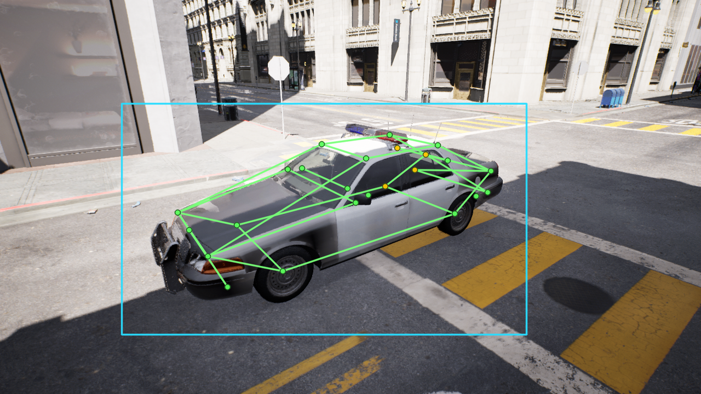

# From road placement to vehicle labels

Explore four real artifacts from the UE5 capture workflow: road geometry, projected keypoints, rendered camera poses, and dataset labels.

<section class="sc-explorer" data-showcase="pipeline" data-owner="kiselyovd" aria-label="From road placement to vehicle labels interactive showcase">
  

  

    <figure class="sc-stage"><figcaption>Explore four real artifacts from the UE5 capture workflow: road geometry, projected keypoints, rendered camera poses, and dataset labels.</figcaption></figure>
    <aside class="sc-details"><h3>Explore the example</h3>
Use the controls to inspect this project's published artifacts.
</aside>
  

  
The source example is available above; interactive controls load when JavaScript is enabled.

  
</section>

## The research result

The published dataset contains 2,510 frames with a 24-point schema. In the completed matched 2D-transfer experiments, adding synthetic data reduced real-data OKS-mAP by 1.7 pp from the weak checkpoint and 9.5 pp from the strong one. The +2 pp criterion was not met.

The capture workflow and its transfer result are separate deliverables. [Read the experiment](https://github.com/kiselyovd/vehicle-keypoints/blob/main/docs/phase0/synthetic-pretraining.md) or [inspect the dataset](https://huggingface.co/datasets/kiselyovd/citysample-vehicle-keypoints-24pt).

The figures are captured/rendered artifacts from the published documentation. Epic asset files are excluded from the dataset; see [provenance and terms](legal/CITY_SAMPLE_EULA_REVIEW.md).

## Sources and reproduction

The explorer uses published artifacts from [kiselyovd/ue5-vehicle-synth](https://github.com/kiselyovd/ue5-vehicle-synth). [Inspect the pinned source](https://github.com/kiselyovd/ue5-vehicle-synth/blob/72bb1884b58580e7aa41aeb1096268d2d1167578/docs/pipeline.md) and the [structured showcase data](assets/showcase/data.json).

UI state stays in the current page. Detailed diagnostic events can be enabled with `?debug=1`; they contain selected IDs and modes, not sample content.

## See also

- [Project overview](index.md)
- [Capture pipeline](pipeline.md)
- [Source repository](https://github.com/kiselyovd/ue5-vehicle-synth)
